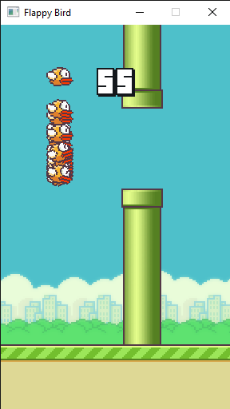
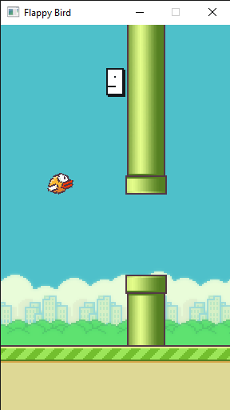

# FlappyBird

**FlappyBird** is a simple implementation of a classic Flappy Bird game, with an added neural-network-based AI that can learn to play the game automatically

 

  
  

## Features
- Playable Flappy Bird
- Neural Net training mode

## Credits
- Art used comes from https://github.com/samuelcust/flappy-bird-assets
- Graphics rendering and window comes from [ScypLib](https://github.com/Scypo/ScypLib)
